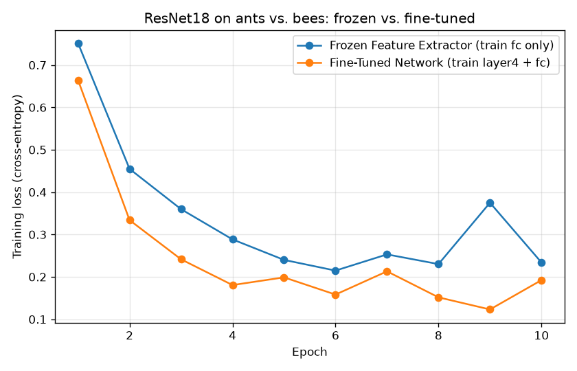

# CS 5720 Neural Networks and Deep Learning

# Home Assignment 3

**Course:** CS 5720 Neural Networks and Deep Learning, Fall 2026
**University:** University of Central Missouri
**Student:** Jeffrey Agnitsch
**Student ID:** 7005146960

---

## How to Install and Run

**Requirements:** Python 3.12+, git. A GPU is optional; the script uses one if PyTorch can see it and falls back to CPU otherwise.

```bash
# 1. Clone the repo
git clone https://github.com/deathscythe272/cs5720-home-assignment-3.git
cd cs5720-home-assignment-3

# 2. Create and activate a virtual environment
python -m venv .venv
# Windows:
.venv\Scripts\activate
# Linux / macOS / WSL:
source .venv/bin/activate

# 3. Install dependencies
pip install -r requirements.txt
```

**Run each question separately:**

```bash
python home_assignment_3.py --q 1
python home_assignment_3.py --q 2 --epochs 10
```

Q1 is instant and uses only NumPy. Q2 downloads the ants-vs-bees dataset (45 MB) into `data/` on first run and the ImageNet ResNet18 weights (45 MB) into the torchvision cache, then trains both experiments. On the GPU used here it takes under a minute; on CPU expect several minutes. Every run writes its printed output to `outputs/` and Q2 also saves `outputs/q2_training_loss.png`.

Results below were produced on an AMD Radeon RX 9070 XT (ROCm 6.4, PyTorch 2.6) under WSL2 Ubuntu 24.04.

---

# Part I: Short-Answer Questions

## Question 1: Convolution, Padding, and Stride

Input 32 × 32 × 3, 16 filters of size 5 × 5, stride 1, padding 0.

**a.** N = 32 (input height/width), F = 5 (filter size), S = 1 (stride), P = 0 (padding).

**b.** Using N_out = (N − F + 2P) / S + 1:

N_out = (32 − 5 + 2·0) / 1 + 1 = 27 + 1 = **28**, so the output feature map is **28 × 28**.

**c.** Each filter produces one output channel, so the complete output volume is **28 × 28 × 16**.

**d.** To keep the spatial size at 32 × 32 with stride 1, the padding must satisfy (32 − 5 + 2P) / 1 + 1 = 32, which gives 2P = 4 and **P = 2**. In general "same" padding for stride 1 is P = (F − 1) / 2.

## Question 2: CNN Architectures

**a. AlexNet.** AlexNet showed in 2012 that a deep CNN trained on GPUs could win ImageNet by a large margin (top-5 error 15.3% vs 26.2% for the runner-up). It made several ideas standard practice: ReLU activations instead of tanh/sigmoid for faster training, dropout in the fully connected layers to fight overfitting, heavy data augmentation, and splitting the network across two GPUs to fit it in memory.

**b. VGGNet and 3 × 3 filters.** Two stacked 3 × 3 convolutions have the same receptive field as one 5 × 5, and three stacked 3 × 3 have the same receptive field as one 7 × 7, but with far fewer weights: three 3 × 3 layers with C channels cost 3 · (3 · 3 · C²) = 27C² parameters versus 49C² for a single 7 × 7. The stack also inserts a ReLU after every layer, so the network gets more nonlinearity per unit of receptive field, which makes the learned function more expressive while being cheaper to train.

**c. Inception module.** Instead of choosing one filter size per layer, the Inception module runs several operations in parallel on the same input (1 × 1, 3 × 3, 5 × 5 convolutions and a 3 × 3 max pool) and concatenates their outputs along the channel axis, letting the network pick up features at multiple scales at once. To keep this affordable, 1 × 1 convolutions are placed before the 3 × 3 and 5 × 5 branches as "bottlenecks" that reduce channel depth, so GoogLeNet is deeper than VGG while using about 12× fewer parameters.

**d. Residual learning.** ResNet addresses the degradation problem: past a certain depth, plain networks get *worse* training error, not just worse test error, so the issue is optimization rather than overfitting. A residual block adds a skip connection so the block only has to learn F(x) = H(x) − x, the difference from identity. Learning "do nothing" is now trivial (push the weights toward zero), and gradients can flow backward through the shortcut without passing through any weight layers, which avoids the vanishing-gradient problem and allows networks of 100+ layers to train.

## Question 3: Representation Learning and Transfer Learning

**a.** Representation learning means the model learns the features (the representation) from raw data as part of training, instead of relying on hand-designed features such as SIFT or HOG. In a CNN the convolutional layers *are* the learned feature extractor; the classifier on top only sees what those layers produce.

**b.** The first convolutional layers have very small receptive fields and look at raw pixels, so the only useful things they can detect are generic edges, color blobs, and simple gradients, and those are the same for nearly every image task. Deeper layers combine the outputs of earlier layers over larger and larger regions, so they respond to textures, object parts, and eventually whole objects, which is specific to the training data and task. Lower layers are general; higher layers are specialized.

**c.** Transfer learning reuses knowledge from a network trained on a large source task (usually ImageNet) for a different target task, instead of starting from random weights. Fine-tuning is the form of transfer learning where some or all of the pretrained weights are allowed to keep training on the new data, usually with a small learning rate so the useful features are adjusted rather than destroyed.

**d.** A deep CNN has millions of parameters, and a small dataset gives it nowhere near enough examples to learn good low-level filters from scratch, so it will overfit badly and train slowly. A pretrained CNN already contains those generic filters learned from over a million images, so only the task-specific top needs to be learned from the small dataset. The result is less data needed, much shorter training, and typically higher accuracy, which is exactly what Part II Q2 below shows.

**e.** A frozen layer has gradient computation turned off (`requires_grad = False` in PyTorch), so its weights never change and the backward pass stops before it; it acts as a fixed feature extractor. A fine-tuned layer keeps gradient computation on, so its weights are updated by the optimizer during training on the new data, usually with a lower learning rate than the freshly added layers.

---

# Part II: Programming Questions

## Q1: Implement Convolution from Scratch

### What the code does

`conv2d_scratch(x, w, stride, padding)` performs 2-D convolution with plain Python loops over NumPy arrays and no built-in convolution function. The input and filter from the assignment are stored as NumPy arrays, the 3 × 3 filter is slid across the 5 × 5 input one pixel at a time, and at each position the overlapping window is multiplied element-wise with the filter and summed (the dot product). The result is written into an output array whose size comes from (N − F + 2P) / S + 1. The script prints the feature map and its shape, then repeats the operation with stride 2 to show the effect.

A note on terminology: deep-learning frameworks implement "convolution" as cross-correlation (the filter is not flipped). The code does the same. For this filter it makes no difference anyway, because the filter is symmetric under a 180° rotation.

### Output

```
Input (5x5):
[[1 1 1 0 0]
 [0 1 1 1 0]
 [0 0 1 1 1]
 [0 0 1 1 0]
 [0 1 1 0 0]]

Filter (3x3):
[[1 0 1]
 [0 1 0]
 [1 0 1]]

Output feature map (stride=1, padding=0):
[[4 3 4]
 [2 4 3]
 [2 3 4]]
Output shape: (3, 3)

For comparison, stride=2, padding=0:
[[4 4]
 [2 4]]
Output shape: (2, 2)
```

The output size is (5 − 3 + 0) / 1 + 1 = 3, so a 3 × 3 feature map. The top-left value 4 comes from the window `[[1,1,1],[0,1,1],[0,0,1]]` multiplied with the filter: 1·1 + 1·0 + 1·1 + 0·0 + 1·1 + 1·0 + 0·1 + 0·0 + 1·1 = 4.

### Effect of changing the stride from 1 to 2

Stride 2 moves the filter two pixels at a time instead of one, so it visits only every other valid position in each direction. The output size drops from (5 − 3) / 1 + 1 = 3 per side to (5 − 3) / 2 + 1 = 2 per side, so the 3 × 3 feature map becomes 2 × 2, keeping just the four corner values of the stride-1 result (4, 4, 2, 4). In general, stride S divides the output resolution by roughly S, which cuts computation by about S² and acts as a built-in downsampling step, at the cost of skipping some positions and therefore some spatial detail.

---

## Q2: Transfer Learning: Freeze vs. Fine-Tune

### What the code does

The script loads an ImageNet-pretrained ResNet18 from torchvision and trains it twice on the two-class ants-vs-bees dataset (244 training images, 153 validation images) with identical settings: 10 epochs, batch size 16, SGD with learning rate 0.001 and momentum 0.9, the same random seed, and the same augmentation (random resized crop + horizontal flip for training, resize + center crop for validation, ImageNet normalization).

- **Experiment A, Frozen Feature Extractor.** Every pretrained parameter is set to `requires_grad = False`. The 1000-way ImageNet classifier (`model.fc`) is replaced with a new `nn.Linear(512, 2)`, and only that layer is passed to the optimizer.
- **Experiment B, Fine-Tuned Network.** Same replacement classifier, but the last convolutional block (`model.layer4`, two residual BasicBlocks at 512 channels) is unfrozen as well and trained together with the classifier.

For each experiment the script reports trainable vs. total parameters, the training loss and validation accuracy per epoch, wall-clock training time for the 10 epochs, and a pure-compute benchmark (ms per forward+backward+update step on a synthetic batch, with no data loading) that isolates the cost freezing is supposed to save. Before timing starts, each experiment does one untimed warm-up epoch; see the note at the end of this section for why.

### Output

```
Device: cuda (AMD Radeon RX 9070 XT)
PyTorch 2.6.0+rocm6.4.2.git76481f7c
Classes: ['ants', 'bees']
Train images: 244   Val images: 153
Epochs: 10   Batch size: 16   LR: 0.001   Optimizer: SGD(momentum=0.9)

======================================================================
Experiment A - Frozen Feature Extractor (train fc only)
======================================================================
Total parameters     : 11,177,538
Trainable parameters : 1,026  (0.01%)
Compute per step     : 44.8 ms (forward+backward+update, batch 16, no data loading)
Epoch  1/10  train loss 0.7513  val acc 69.28%
Epoch  2/10  train loss 0.4548  val acc 91.50%
Epoch  3/10  train loss 0.3598  val acc 90.85%
Epoch  4/10  train loss 0.2884  val acc 94.77%
Epoch  5/10  train loss 0.2401  val acc 94.77%
Epoch  6/10  train loss 0.2148  val acc 93.46%
Epoch  7/10  train loss 0.2531  val acc 94.12%
Epoch  8/10  train loss 0.2302  val acc 93.46%
Epoch  9/10  train loss 0.3750  val acc 93.46%
Epoch 10/10  train loss 0.2340  val acc 96.08%
Training time        : 14.3 s
Final val accuracy   : 96.08%
Best val accuracy    : 96.08% (epoch 10)

======================================================================
Experiment B - Fine-Tuned Network (train layer4 + fc)
======================================================================
Total parameters     : 11,177,538
Trainable parameters : 8,394,754  (75.10%)
Compute per step     : 58.3 ms (forward+backward+update, batch 16, no data loading)
Epoch  1/10  train loss 0.6640  val acc 83.66%
Epoch  2/10  train loss 0.3340  val acc 93.46%
Epoch  3/10  train loss 0.2415  val acc 92.81%
Epoch  4/10  train loss 0.1807  val acc 94.77%
Epoch  5/10  train loss 0.1989  val acc 94.12%
Epoch  6/10  train loss 0.1582  val acc 94.12%
Epoch  7/10  train loss 0.2131  val acc 93.46%
Epoch  8/10  train loss 0.1517  val acc 94.12%
Epoch  9/10  train loss 0.1231  val acc 94.77%
Epoch 10/10  train loss 0.1923  val acc 94.12%
Training time        : 17.2 s
Final val accuracy   : 94.12%
Best val accuracy    : 94.77% (epoch 4)
```

The trainable-parameter counts check out by hand: the new classifier is 512 × 2 weights + 2 biases = 1,026, and `layer4` of ResNet18 holds 8,393,728 parameters, so 8,393,728 + 1,026 = 8,394,754.

### Training loss plot



### Comparison table

| Method | Trainable Parameters | Training Time (10 epochs) | GPU Compute per Step | Accuracy (val, final) | Accuracy (val, best) |
|---|---|---|---|---|---|
| Frozen Feature Extractor | 1,026 of 11,177,538 | 14.3 s | 44.8 ms | 96.08% | 96.08% |
| Fine-Tuned Network | 8,394,754 of 11,177,538 | 17.2 s | 58.3 ms | 94.12% | 94.77% |

### Discussion

Both approaches land in the same neighborhood on the validation set, 96.1% frozen versus 94.1% fine-tuned, and on 153 validation images that gap is three pictures, so it is within run-to-run noise rather than a real win for either side. The fine-tuned network does fit the training data better (final training loss 0.19 versus 0.23, and its curve sits below the frozen curve from epoch 2 onward) because the 8.4 M weights in `layer4` can reshape the features for ants and bees, whereas the frozen model can only draw a linear boundary through fixed ImageNet features. That extra capacity did not turn into validation gains here because 244 training images are far too few to constrain 8.4 M parameters, so part of the training-loss reduction is memorization rather than generalization. Training time differs because of the backward pass, not the forward pass: both models run the identical forward computation, but the frozen model stops backpropagation at the classifier, while the fine-tuned model must also compute gradients through the two residual blocks of `layer4` and update their weights, which shows up as 58 ms versus 45 ms per step and 17 s versus 14 s overall. The gap would be much larger if every layer were unfrozen or if the dataset were bigger, since on this tiny set image decoding is a large share of the wall-clock time and dilutes the compute difference. For a small dataset that resembles ImageNet, freezing is the better default: it is faster, it is nearly impossible to overfit with 1,026 parameters, and here it was also the more accurate option. Fine-tuning earns its cost when the target domain differs from ImageNet (medical scans, satellite imagery, drawings) or when there is enough data to use the extra capacity, ideally with a lower learning rate for the unfrozen block and early stopping on validation accuracy.

### A note on fair timing

The first version of this script timed Experiment A at 31.9 s and Experiment B at 23.6 s, the opposite of what the parameter counts predict. The reason was ordering, not freezing: Experiment A ran first and paid every one-time cost (spawning DataLoader workers, decoding all JPEGs into the OS file cache, and the GPU runtime selecting kernels for each layer shape), and Experiment B inherited a warm system. The script now runs one untimed warm-up epoch plus a few synthetic batches before starting the clock for each experiment, and additionally reports a pure-compute ms-per-step figure with no data loading at all. With that bias removed the numbers line up with the theory.
